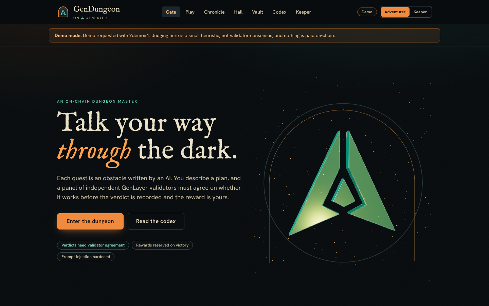

# GenDungeon

An on-chain AI Dungeon Master for [GenLayer](https://www.genlayer.com). You pay an entry fee, the contract's validators
write you an obstacle, you answer in your own words, and the same validators judge your plan. Rewards come from a pool
that the players themselves fill.



The game is an **Intelligent Contract**: a Python contract whose consensus includes LLM calls. Language models decide
only what a language model is good at (is this plan relevant, plausible, creative). Everything that touches money, rank
or state is ordinary deterministic code that every validator re-derives.

- Contract: [`contracts/GenDungeon.py`](contracts/GenDungeon.py), version 2.0.0
- Web app: Vite, React, Tailwind, three.js, [`genlayer-js`](https://www.npmjs.com/package/genlayer-js)
- Current deployment (v2) on GenLayer Studio: `0xF7eb3Aa417c155814EB44247A1308EB23Fc02805`, verified by the live end-to-end run in [reports/LATEST-live.md](reports/LATEST-live.md)
- First release (v1) on GenLayer Studio: `0xc49d63f60e651700777fA35d0F0aF05AF5AeA928` (the app reads it in legacy mode)

## What is new in v2

| Area | v1 | v2 |
|---|---|---|
| Verdict | One LLM call returned a score and a success flag. | The LLM reports three rubric scores and a tamper flag. The contract computes the verdict from them. |
| Empty pool | A win against an empty pool could never be claimed and locked the player out. | Zero-reward victories are claimable, so the slot is always released. |
| Accounting | A reward left the free pool at verdict time, but deposits, reservations and payouts were not tracked, so the books could not be audited. | Deposits, reservations and payouts are counted separately; `get_treasury` proves they add up and reports solvency. |
| Size of one win | A win could take the entire pool. | A per-quest payout cap (50% of the pool by default). |
| Prompt injection | Player text went into the prompt as it was. | Sanitising, a normalising marker filter, untrusted-data framing, a validator-side scenario audit, a tamper flag that always fails a quest. |
| Difficulty | One flat game. | Three tiers with their own fee, pass mark, reward and renown. |
| Progression | Win and loss counters. | Renown, six ranks, win streaks, an on-chain hall of fame. |
| Operations | Owner could change fees. | Payout cap, quest expiry, pause switch, two-step ownership transfer. |
| Observability | Getters for config, quests, stats, history and the open feed. | Treasury view with a books-balance invariant and a solvency check, quote and dry-run views, events. |
| Frontend | One page with panels and a transaction overlay. | Seven pages, a three-dimensional hero, a demo mode, self-hosted fonts, a lazy-loaded live runtime. |
| Verification | 5 tests. | 276 contract tests, mutation testing, 82 TypeScript tests, an accessibility audit and a live end-to-end suite with adversarial scenarios that has passed on GenLayer Studio. |

The full change list is in [CHANGELOG.md](CHANGELOG.md); the reasoning is in [docs/](docs/).

## Quick start

```bash
npm ci
npm run dev          # http://localhost:5173
```

By default the app opens on the deployed v2 contract (`0xF7eb3Aa417c155814EB44247A1308EB23Fc02805`, `DEPLOYED_V2_ADDRESS` in `src/lib/env.ts`), so a
hosted build needs no environment variable. Add `?demo=1` to the address for **demo mode**: an in-memory model of the
contract, with the same rules, the same messages and a deterministic stand-in for the judges. Nothing is sent anywhere.
Use it to see every screen without a wallet.

### Connect to another contract

```bash
cp .env.example .env
# set VITE_CONTRACT_ADDRESS=0x...   (any GenDungeon v2 deployment; empty keeps the default)
npm run dev
```

Or open the app with `?contract=0x...` in the address. The app accepts a MetaMask account or creates a burner account
in the browser. Reads and writes go through `genlayer-js` to GenLayer Studio.

### Deploy your own

Either paste `contracts/GenDungeon.py` into GenLayer Studio and deploy with the constructor arguments
`entry_fee`, `min_reward`, `max_reward` (all in wei), or let the end-to-end script do it and print the address:

```bash
npm run e2e:live:quick
```

## Pages

| Route | Purpose |
|---|---|
| `#/` | The gate: three-dimensional hero, the three doors, a hall-of-fame preview, what is new in v2 |
| `#/play` | Choose a door, read the obstacle, write an action, watch consensus, claim |
| `#/chronicle` | Every quest you have played, with filters |
| `#/hall` | The on-chain hall of fame and the feed of open quests |
| `#/vault` | Treasury, books-balance invariant, reward calculator |
| `#/codex` | Rules, scoring formula, security model, v1 to v2 changes |
| `#/keeper` | Owner controls: fees, payout cap, quest time limit, pause, ownership |

## Verify everything

```bash
pip install -r requirements-dev.txt
npm run test:contract     # 276 contract tests (GenVM direct mode, LLM mocked)
npm run mutation          # 14 deliberate contract bugs, every one must be caught
npm run check             # typecheck, 82 TypeScript tests, production build
npm run e2e:dry           # all end-to-end scenarios against the in-memory model
npm run e2e:live          # the same scenarios against a freshly deployed contract on GenLayer
npm run e2e:commit        # commit the newest live report (refuses anything that is not a real run)
```

`e2e:dry` is a check of the scripts and the report generator. Only `e2e:live` produces evidence about the contract.
See [docs/E2E.md](docs/E2E.md), including how to run it in a GitHub Codespace.

## Repository layout

```
contracts/GenDungeon.py     the Intelligent Contract
tests/                      contract tests, fuzzing, security and economy suites
scripts/mutation_check.py   mutation testing for the contract
scripts/logo, scripts/ui    logo tracing, screenshot capture, accessibility and performance audits
src/lib/                    rules, formatting, GameApi, live client, in-memory model
src/state, src/pages        stores, transactions overlay, the seven pages
src/components              logo, emblem, 3D hero, score bars, doors
e2e/live/                   end-to-end harness, suites, report generator
docs/                       architecture, security, economy, testing, E2E, UI and performance
reports/                    committed live end-to-end reports
.devcontainer/, .github/    Codespaces setup and CI workflows
```

## Documentation

| Document | Contents |
|---|---|
| [docs/ARCHITECTURE.md](docs/ARCHITECTURE.md) | Contract design, consensus, frontend layers |
| [docs/CONTRACT_API.md](docs/CONTRACT_API.md) | Every method, who may call it, what it reverts with |
| [docs/SECURITY.md](docs/SECURITY.md) | Threat model and the defences against each threat |
| [docs/ECONOMY.md](docs/ECONOMY.md) | Fees, rewards, reservations, the books-balance invariant |
| [docs/TESTING.md](docs/TESTING.md) | Test layers, mutation testing, what is and is not covered |
| [docs/E2E.md](docs/E2E.md) | The live end-to-end suite, Codespaces, reports |
| [docs/UI.md](docs/UI.md) | Design language, the logo, 3D, accessibility, performance numbers |
| [docs/MILESTONE.md](docs/MILESTONE.md) | Milestone summary and evidence table |
