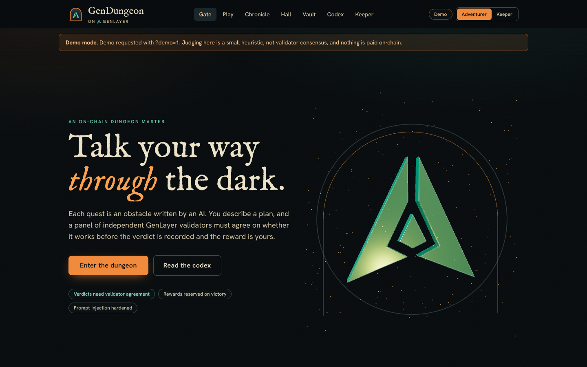
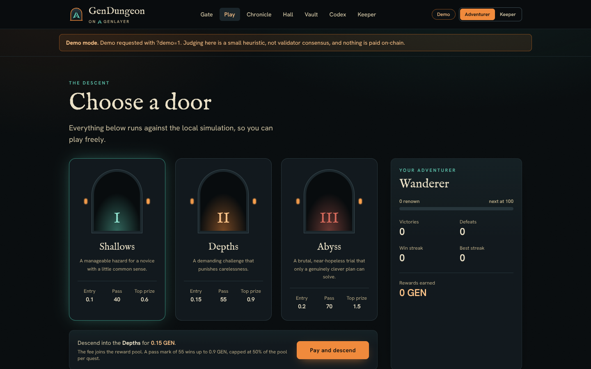
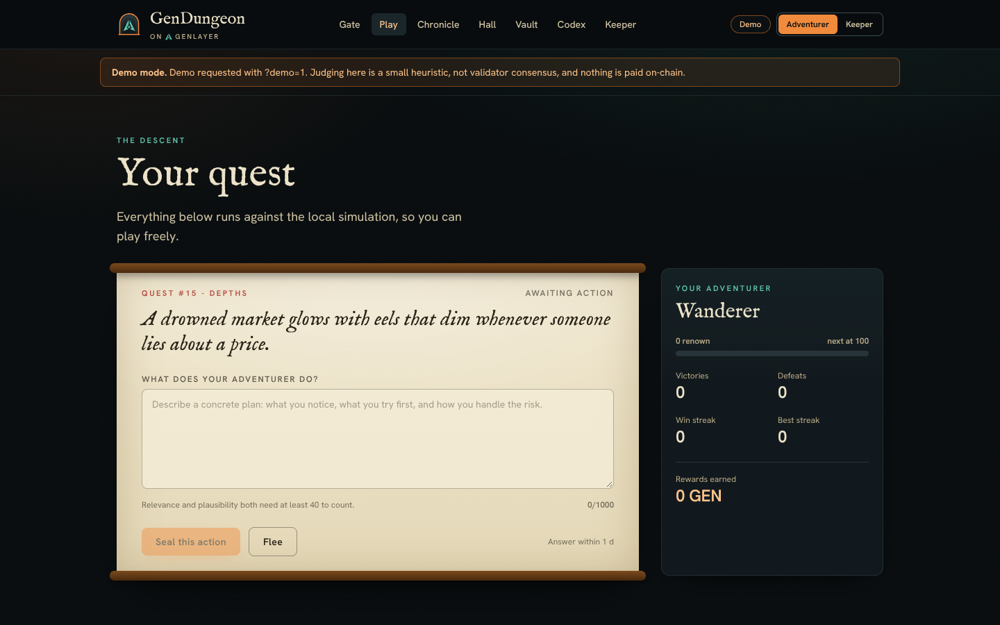
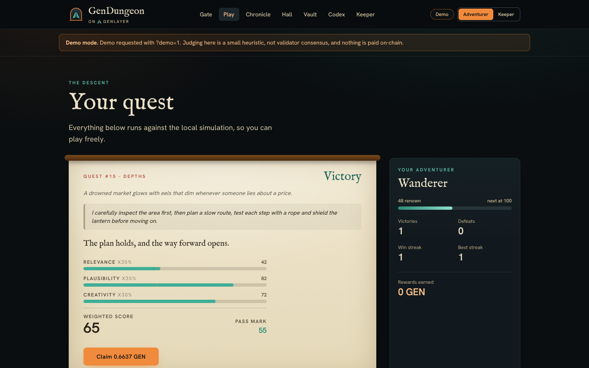
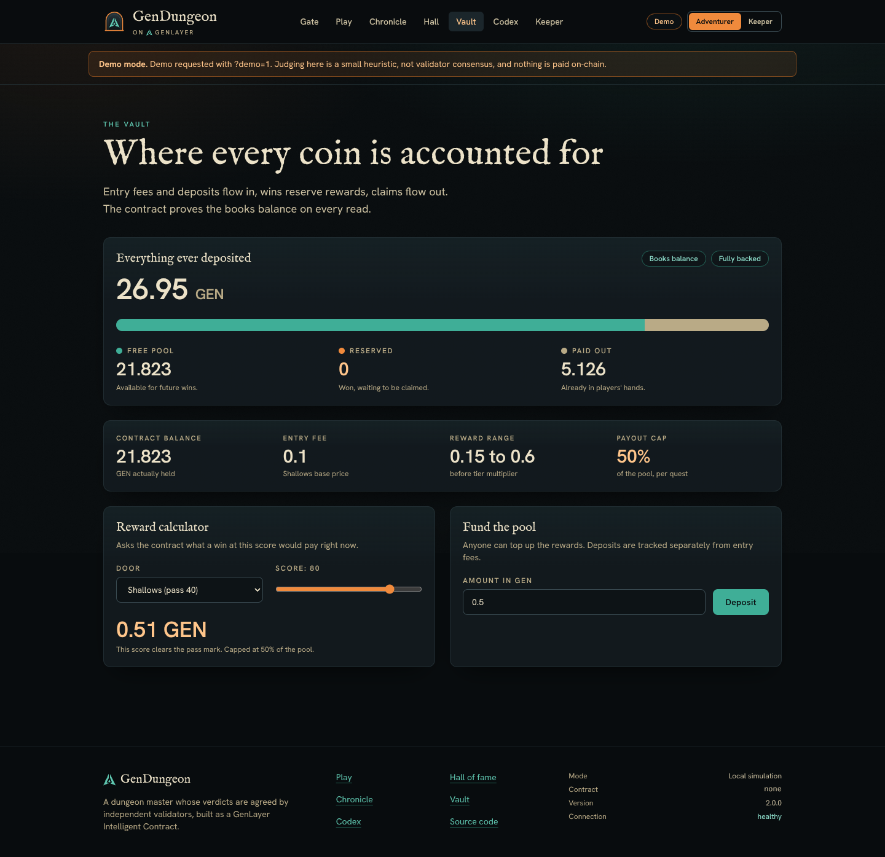

# Interface, logo and performance

## Design language

The setting is a flooded dungeon lit by a single torch. Everything is chosen to carry that:

| Token | Value | Used for |
|---|---|---|
| Basalt | `#080c0e` and a grey ramp | Surfaces |
| Verdigris | `#5fc7b0` | The GenLayer side: links, validators, success |
| Ember | `#f08a3c` | The player side: primary actions, rewards |
| Vellum | `#ece2c8` | Text, and the parchment scroll that holds the obstacle and the verdict |
| Oxblood | red ramp | Danger, tampering, defeat |

Type: **IM Fell English** for display, **Hanken Grotesk** for interface text. IM Fell uses old-style figures (a one looks
like a capital I), so every number is set in the sans face through the `.num` class. Both families are self-hosted
through Fontsource, so the page makes no third-party font request.

## The logo

The mark comes from the official GenLayer logo supplied with the task. It is **traced, not redrawn**:
`scripts/logo/trace_mark.py` thresholds the image, extracts sub-pixel contours, finds the corners, fits one straight
line per edge and intersects neighbouring lines to restore sharp corners, then normalises the result into a 100 by 100
box. It writes the same three polygons twice, as an SVG path (`src/assets/genlayer-mark.svg`) and as data
(`genlayerMark.ts`) that the 3D hero extrudes. The script rasterises its own output and compares it with the source:
**intersection over union 0.9988**. Running it again produces byte-identical files.

`GenLayerMark` renders the mark as an inline SVG that takes the current text colour. `Emblem` is the GenDungeon logo:
the mark standing inside a dungeon archway. The doorway is the dungeon, the mark is the validator network that judges
it. The same emblem is the favicon (`public/favicon.svg`).

## Pages

| Route | Highlights |
|---|---|
| Gate | Three-dimensional hero, three arched doors for the tiers with a pointer-driven tilt, hall preview |
| Play | Staged flow with the vellum scroll, live action validation (`validate_action` or its local twin), the consensus overlay |
| Chronicle | Every quest with filters, scores as bars, rewards and outcomes |
| Hall | Hall of fame and the feed of open quests |
| Vault | The books-balance invariant, solvency, a reward calculator backed by `quote_reward` |
| Codex | Rules, formulas, security model and the v1 to v2 comparison |
| Keeper | Owner controls; every field is checked against the contract's bounds before a transaction is sent |

All screenshots in `docs/assets/screens/` are produced by `npm run ui:capture` from the demo mode: seven routes at
desktop and phone width, plus the full play flow. The capture script exits with an error on any console error or failed request, and it records
horizontal overflow per page; the last run reported no problems and 0 px of overflow on all 14 pages.

## Three-dimensional hero

`HeroScene` (three.js) extrudes the traced mark into a lit solid inside an arch, with a drifting ring, 240 ember
particles and a flickering torch light that follows the pointer. It is built to be skippable and cheap:

- It is a separate lazy chunk and is only requested when WebGL is available.
- It falls back to the static emblem when WebGL is missing, when the visitor prefers reduced motion, when
  `?lowfx=1` is in the address, and when the WebGL context is lost.
- It stops rendering when scrolled out of view or when the tab is hidden.
- **Adaptive quality**: after a short warm-up it counts slow frames; if most are slow it drops to pixel ratio 1 and a
  third of the particles, once.
- Every geometry, material and the renderer are disposed on unmount.

## Accessibility

`npm run ui:a11y` loads every route at 1440 px and 390 px and runs axe-core with the WCAG 2 A and AA rule sets. The last
run: **14 page and width combinations, no violations**. The audit found and fixed three real problems during
development (an invalid definition list, links distinguished from text by colour alone, a scrollable region that could
not be reached by keyboard). Other measures: visible focus rings, `aria-live` regions for the consensus overlay, honest
labels on the arched doors, and `prefers-reduced-motion` support that removes the hero motion and shortens transitions.

## Performance

Measured with `npm run ui:perf` on a software-rendered headless Chromium (no GPU), against the production build served
by `vite preview`. Byte counts are exact; timings are relative and will be better on real hardware.

### What the first visit downloads

| | v1 | v2, gate with 3D hero | v2, gate without 3D (`?lowfx=1`) | v2, other pages |
|---|---|---|---|---|
| JavaScript (compressed) | 174 kB, one file | 199 kB | 71 kB | 74 to 76 kB |
| CSS (compressed) | not measured | 10 kB | 10 kB | 10 kB |
| Fonts | loaded from Google Fonts | 149 kB self-hosted | 149 kB | 92 kB |
| Third-party requests | yes (fonts) | none | none | none |
| First contentful paint (software renderer) | not measured | 272 ms | 92 ms | 44 to 80 ms |

Read this table without spin:

- The **gate with the 3D hero is heavier than v1's single page**, by about 25 kB of JavaScript. The hero is the price of
  the visual effects. It loads after the first paint and is skipped entirely for visitors who cannot or should not run it.
- Everything else is much lighter than v1, because the app is split into route chunks (each 1 to 4 kB compressed) and
  three.js is not on the critical path.
- A **live** visit also downloads the `genlayer-js` runtime (about 120 kB compressed), which v1 had in its single
  bundle. For a visitor with a configured contract the total is roughly comparable to v1 and is loaded after the first
  paint. Demo visitors never download it.

Build output for reference (compressed): entry 73.2 kB, three.js hero chunk 130.8 kB, live runtime 120.4 kB, CSS 10.5 kB.

### Rendering cost

Three paint-heavy habits were removed after profiling the first version of the new interface in the same Chromium:
`mix-blend-mode` on a full-screen noise layer, `background-attachment: fixed` on the ambient glow, and `backdrop-filter`
blur on the sticky header. The backdrop is now two fixed, separately composited layers with normal blending. The stalls these
habits caused in the software renderer are gone; that is a statement about repaint cost on a CPU-rendered page, not a
claim about frames per second on a phone.

### Other measures

- Route-level code splitting; the transaction overlay and pages load on demand.
- One shared, de-duplicated store: every page reads the same snapshot instead of issuing its own contract reads, reads
  run in parallel, a failed read keeps the last good value, and polling pauses while the tab is hidden.
- Contract views are O(limit): history and the open-quest feed are linked lists, not scans.
